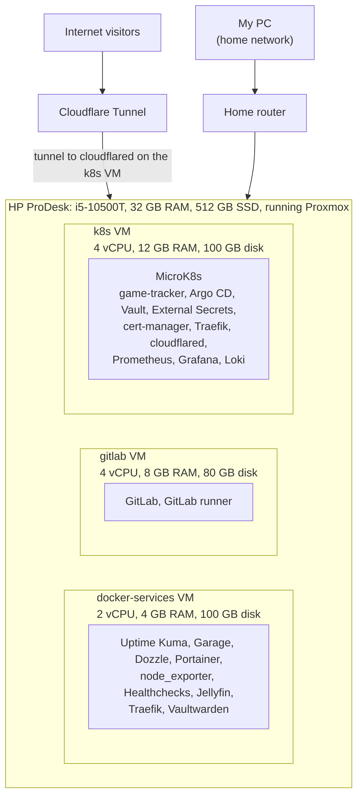
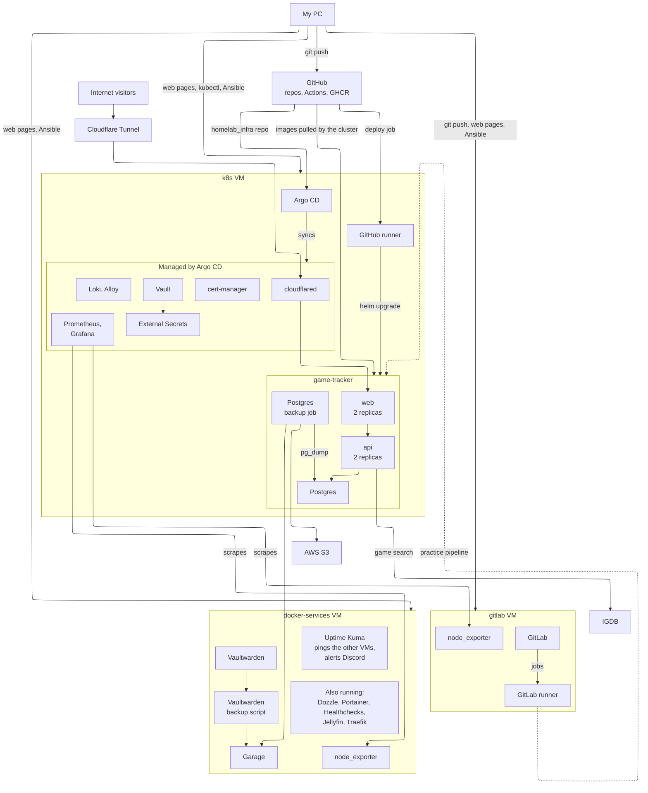

# homelab_infra

Infrastructure code for my homelab: a single server running Proxmox, with VMs built by Terraform and configured by Ansible. See `plan.md` for the goals and `decisions.md` for why things are built this way.

## Architecture

## How it connects

Vault and External Secrets supply secrets to the cluster, cert-manager issues the certificates, Prometheus, Loki and Alloy monitor everything in the cluster, and `cloudflared` carries the public traffic. Argo CD keeps all of these in sync from this repo.

## Security

- The Cloudflare Tunnel is opened from inside the network, so no ports are open to the internet
- Secrets are in Vault and synced into the cluster by External Secrets. Nothing secret is in git
- cert-manager issues TLS certificates from my own CA for the internal sites
- The VM-level secrets (the GitLab AWS keys, Healthchecks, the Cloudflare DNS token) are in Ansible Vault
- Pull requests to this repo run gitleaks, yamllint, kubeconform and `helm template`. The game-tracker pipeline adds Trivy and CodeQL

## Apps

Apps keep their own deploy code in their own repo, so a change to the code and its Helm chart can go out together.

- **game-tracker:** [repo](https://github.com/cel6586/game-tracker), [Helm chart](https://github.com/cel6586/game-tracker/tree/main/chart). A GitHub Actions workflow tests the code, builds the images, and deploys the chart to the MicroK8s cluster with `helm upgrade --install`.

The Kubernetes namespace and secrets are applied once by hand from `apps/game-tracker/` (the secret files are not in git).
