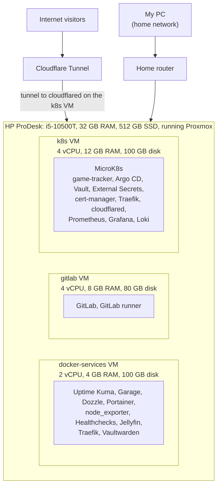
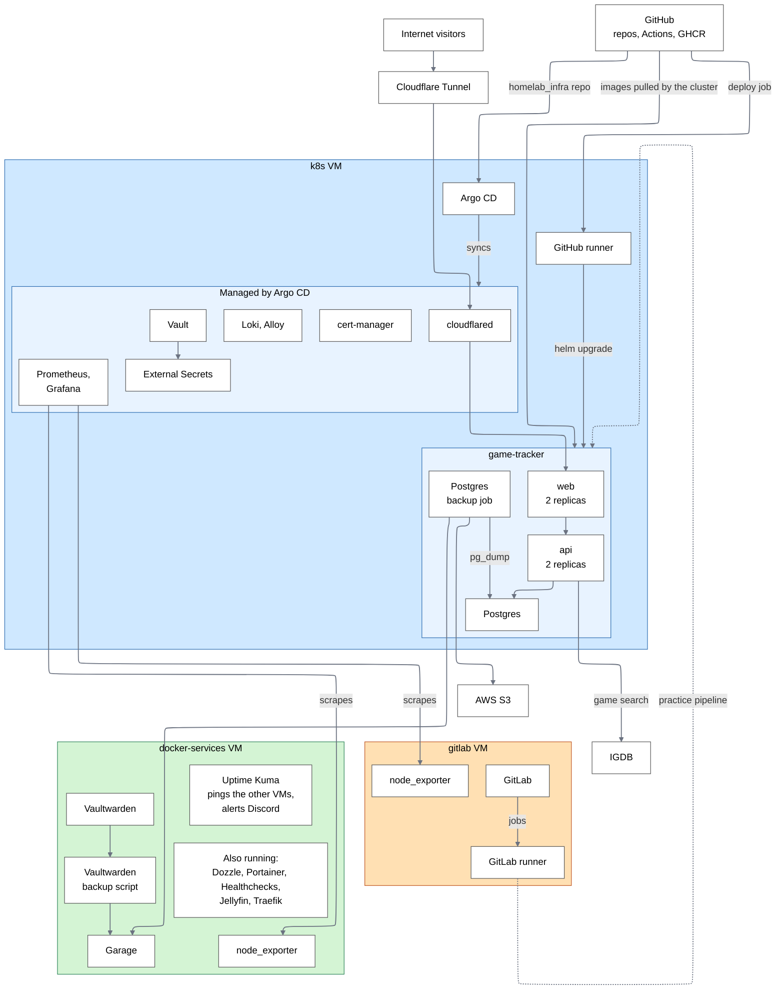
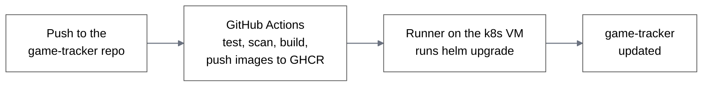
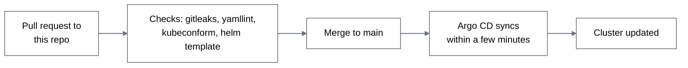

# homelab_infra

Infrastructure code for my homelab: one server (an HP ProDesk) running Proxmox, split into three VMs. Terraform creates the VMs, Ansible configures them, and Argo CD keeps everything inside Kubernetes in sync with this repo. Everything is built from code, so it can be rebuilt from scratch.

## Overall architecture
There are three VMs. The first is a Kubernetes cluster that runs the game-tracker app, Vault for secrets, and Prometheus, Grafana and Loki for metrics and logs. game-tracker is deployed by a GitHub runner after it passes the GitHub CI, and Argo CD syncs the rest of the infrastructure from this repo. The web interfaces, like Vault, Grafana and Argo CD, have an ingress with a certificate, so accessing them is encrypted. A scheduled job backs up the database. A Cloudflare Tunnel on my own domain is set up for opening game-tracker to the internet.  Also hook up discord for alerts when there is any issues.

The second VM runs GitLab and a GitLab runner. game-tracker is also on GitLab, where I rebuilt its CI/CD pipeline as practice, and I keep GitHub up to date too. GitLab's metrics go to Prometheus on the k8s VM.

The third VM runs Docker services. Uptime Kuma checks whether the other VMs go down, Garage holds local backups of the Postgres database and Vaultwarden, Dozzle shows the logs of my containers, Jellyfin is a media server for my home, and Vaultwarden is my personal password manager. Its metrics go to Prometheus too.

- `plan.md`: goals, order of work, what's out of scope
- `decisions.md`: what I decided and why
- `layout.md`: VM sizes
- `troubleshooting.md`: problems I hit and how I fixed them

## What's running

| VM | What it's for | What runs on it |
|---|---|---|
| `k8s` | Kubernetes cluster | MicroK8s, game-tracker, Argo CD, Vault, External Secrets, cert-manager, Traefik, cloudflared, Prometheus, Grafana, Loki, Alloy, a GitHub Actions runner |
| `gitlab` | Self-hosted GitLab | GitLab, GitLab runner |
| `docker-services` | Plain Docker containers | Uptime Kuma, Garage (S3 storage), Vaultwarden, Traefik, Dozzle, Portainer, Healthchecks, Jellyfin, node_exporter |

## Architecture



## How it connects



I work on all of it from my PC: `git push`, `kubectl`, Ansible, and the web page of each service.

Vault and External Secrets supply secrets to the cluster, cert-manager issues the certificates, Prometheus, Loki and Alloy monitor everything in the cluster, and cloudflared carries the public traffic. Argo CD keeps all of these in sync from this repo.

## Repo layout

```
terraform/                 creates the VMs in Proxmox
ansible/
  inventory.ini            the three VMs, grouped
  requirements.yml         the Ansible collections it needs
  playbooks/               k8s.yml, gitlab.yml, docker-services.yml, site.yml (all three), update.yml (patch every VM)
  roles/                   one role per piece (common, microk8s, gitlab, gitlab_runner, docker_base, traefik, garage, vaultwarden, ...)
  group_vars/              settings per VM group, secrets in each vault.yml (encrypted)
apps/                      everything Argo CD syncs into the cluster
  argocd/                  root.yml, applications/ (one file per app), values.yaml
  cert-manager/            values, plus ca/ (the homelab CA and the GitLab certificate)
  external-secrets/        the connection to Vault, and the Alertmanager secret
  vault/                   values for the Vault chart
  observability/           values for Prometheus + Grafana, Loki and Alloy
  game-tracker/            namespace, ExternalSecrets, cloudflared, alerts
.github/workflows/         pull request checks
```

The Helm chart and the pipelines for game-tracker are in [its own repo](https://github.com/cel6586/game-tracker), so a change to the code and its chart go out together.

## Setup

Installed Proxmox on my HP Pro desk.  Created a VM template that terraform can copy from to create the VMs with the specifications i need.  Created a user for terraform to use to create the VMs.

## How things get deployed

- **VMs:** `terraform apply`, by hand from my PC.
- **Inside the VMs:** `ansible-playbook`, by hand from my PC (WSL). Nothing runs Ansible for me.
- **Inside Kubernetes:** Argo CD. Merge to `main` and ArgoCD will sync when it sees the updates on github. `apps/argocd/root.yml` watches `apps/argocd/applications/`, and each file there is one thing to install. 
- **game-tracker:** GitHub Actions in its repo builds the images and a runner on the `k8s` VM runs `helm upgrade`. Argo CD only handles its namespace, secrets, tunnel and alerts.

**A change to game-tracker:**



**A change to the infrastructure in Kubernetes:**



## Deploying from scratch

Before starting I need Proxmox installed, an Ubuntu 24.04 cloud-image template VM (ID 9000), an API token for Terraform, an SSH key for Ansible, and Terraform and Ansible on my PC.
1. **Create the VMs.** Copy `terraform/terraform.tfvars.example` to `terraform.tfvars`, fill it in, and give Terraform the token in the `PROXMOX_VE_API_TOKEN` environment variable.

   ```
   cd terraform
   terraform init
   terraform apply
   ```

2. **Build the `k8s` VM.** From `ansible/`:

   ```
   ansible-galaxy collection install -r requirements.yml
   ansible-playbook playbooks/k8s.yml
   ```

3. **Install Argo CD** with `kubectl` on my PC pointed at the cluster:

   ```
   helm repo add argo https://argoproj.github.io/argo-helm
   helm upgrade --install argocd argo/argo-cd -n argocd --create-namespace -f apps/argocd/values.yaml
   kubectl apply -f apps/argocd/root.yml
   ```

   Argo CD then installs cert-manager, External Secrets, Vault, monitoring, Loki and Alloy, and applies the game-tracker namespace, secrets, tunnel and alerts.

4. **Set up Vault by hand.** initialize and unseal first. enable the KV v2 engine at `secret`, add the secrets (see below), then turn on Kubernetes login with a policy and role named `game-tracker`. The policy allows reading `secret/data/game-tracker/*`

5. **On my PC:** add the `*.homelab.internal` names to the hosts file, and trust the homelab CA certificate so the browser doesn't warn.

6. **Build the other two VMs,** with `--ask-vault-pass` because each group has an encrypted `vault.yml`. `gitlab.yml` has to come after step 3, because it reads the GitLab certificate out of the cluster with `kubectl`.

   ```
   ansible-playbook playbooks/gitlab.yml --ask-vault-pass
   ansible-playbook playbooks/docker-services.yml --ask-vault-pass
   ```

7. **game-tracker:** follow its README to register the runner and deploy.

Ansible roles take `--tags <role name>` to run one piece, and playbooks take `--limit <group>`. `update.yml` patches every VM.

## Secrets

Nothing secret is in git.

| Where | What |
|---|---|
| Ansible Vault, `ansible/group_vars/<group>/vault.yml` | `docker_server`: the Garage RPC secret, the Cloudflare DNS token (Traefik uses it for HTTPS certificates), the Healthchecks secret key, and the Garage key for the Vaultwarden backup. `gitlab_server`: the AWS keys for GitLab backups (backups are off). Each is read through a `vars.yml` name that points to its `vault_` twin |
| Vault (HashiCorp), `secret/game-tracker/...` | `app`, `aws-backup`, `local-backup`, `ghcr-pull`, `gitlab-pull`, `cloudflare-tunnel` (all described in the game-tracker README) and `alertmanager` (the Discord webhook for alerts). External Secrets turns each into a Kubernetes Secret |
| Terraform | the Proxmox API token (`PROXMOX_VE_API_TOKEN`) and `terraform.tfvars`, which is gitignored |

I keep these outside the repo and off the VMs: the Vault unseal keys and root token, the Ansible Vault password, and the Argo CD admin password. Vault's data lives only on the `k8s` VM's disk, so a rebuild starts it empty.

## Monitoring and alerts

- Prometheus, Grafana and Alertmanager come from the kube-prometheus-stack chart. Grafana reads Loki for logs, and Alloy ships the pod logs to Loki.
- Prometheus also scrapes node_exporter on the `gitlab` and `docker-services` VMs.
- Alertmanager sends alerts to Discord. game-tracker has two alerts of its own: no running pods, and no good backup in 25 hours. The GitLab alerts are written but turned off, because I sometimes switch that VM off.
- Uptime Kuma pings the other VMs and sends a Discord message when one goes down. Dozzle shows the logs of the Docker containers.

## Backups

- **Postgres:** a nightly job dumps the database to S3 and to Garage.
- **Vaultwarden:** a nightly cron job on `docker-services` archives its data to Garage.
- Garage is on the same VM as Vaultwarden, so that backup protects against mistakes, not against the disk dying.
- GitLab backups exist as a role but are turned off.

## Security

- Secrets are in Vault and synced into the cluster by External Secrets. Nothing secret is in git
- cert-manager issues TLS certificates from my own CA for the internal sites
- The VM-level secrets (the GitLab AWS keys, Healthchecks, the Cloudflare DNS token) are in Ansible Vault
- Pull requests to this repo run gitleaks, yamllint, kubeconform and `helm template`. The game-tracker pipeline adds Trivy and CodeQL

## Planned

- `ansible-lint` and `terraform validate` in the pull request checks
- VM hardening with Ansible: firewall, SSH password logins off, fail2ban
- Proxmox backups of whole VMs
- Deploying game-tracker through Argo CD from the GitLab pipeline
- Jenkins, as practice, and a game server VM if there's RAM
